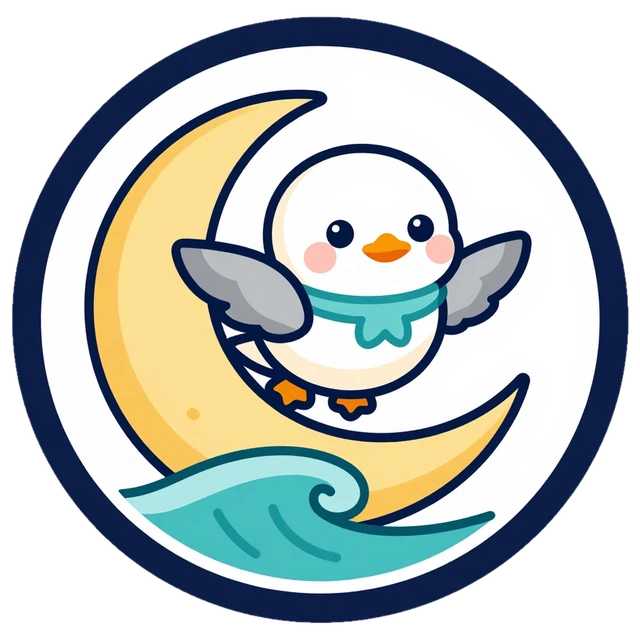

<div align="center">



# نَوْرَس · Nawras

**مَدْرَسَةُ نَوْرَس لِلْفُصْحَى — Nawras Fusha School, San Diego**

*نَتَعَلَّمُ الْفُصْحَى بِفَرَحٍ · Fusha for little hearts, by the Pacific.*

**[Open the site](https://hisham-abuella.github.io/Madrasa/)** ·
**[Owners' presentation](https://hisham-abuella.github.io/Madrasa/pitch/index.html)** ·
**[Web book](https://hisham-abuella.github.io/Madrasa/book/books/noori-shell.html)** ·
**[Book PDF](https://hisham-abuella.github.io/Madrasa/book/print/noori-shell-lulu-interior.pdf)** ·
**[GitHub repo (public)](https://github.com/hisham-abuella/Madrasa)**

</div>

---

A demo for an Islamic Arabic (Fusha) school for children in San Diego, built to show the school owners
what a joyful, consistent Fusha programme could look like. **One lesson, written once, reaches the child four
ways:** on a screen at home, on the classroom TV, in a printed book they write in, and read aloud.

The name: **النَّوْرَس, the seagull**, San Diego's coastal bird, which flies far and comes home, like children
returning to the language of the Qur'an. The mascot is **نُورِي Noori** (from نُور, light).

## What's inside

| | What | Where |
|---|---|---|
| 🏠 | **Hub**: every piece on one page | [`index.html`](index.html) |
| 🎨 | **6 homepage mockups**: Islamic + kid-friendly + San Diego, each a different layout; any theme works on any layout | [`mockups/`](mockups/) |
| 🕊️ | **6 logo concepts**, generated locally, wordmark typeset (recommended: #1 Gull & Crescent, #6 as app icon) | [`logos/`](logos/) |
| 📖 | **One grammar lesson, three styles**: هَذَا وَهَذِهِ (masculine & feminine) as an article, an illustrated story, and a classroom presentation | [`lessons/`](lessons/) |
| ✍️ | **Writing pad** for iPad / Apple Pencil / mouse in every lesson (trace ة, هَذَا, هَذِهِ, write a sentence; praised, never graded) | [`assets/kids.js`](assets/kids.js) `KS.writePad` |
| 📚 | **Lesson book** «نُورِي وَالصَّدَفَةُ الصَّغِيرَةُ»: 32 pages, Lulu-ready, 11 exercise pages, QR to the web book, narrated | [`book/`](book/) |
| 🖼️ | **Illustrated artwork set**: 53 local generations + book art, with a simple/illustrated switch and SVG fallback | [`assets/art/`](assets/art/) |
| 🎬 | **Image & animation guide**: characters, prompts, seeds, motion rules, live demos, pre-ship checklist | [`guide.html`](guide.html) |
| 🎤 | **Owners' presentation** (the main slide on the hub): the whole effort in ~10 minutes, live website, theme & logo switchers; presenter speaks from the notes | [`pitch/index.html`](pitch/index.html) |

## The six looks

| Theme | Mood |
|---|---|
| **Andalus** | horseshoe arches and zellige, linked to San Diego's Spanish-mission arches |
| **Pacific** (flagship) | sunset ocean, waves, palms, Noori flying |
| **Fanous** | night sky, crescent, lanterns that light on tap |
| **Kurrasa** | a madrasa notebook: tabs, sticky notes, Naskh headings |
| **Mosaic** | bold 8-point stars, chunky outlines, playground bento |
| **Mihrab** | calm pastels and one soft arch, for parents and older kids |

## The lesson book

| File | Use |
|---|---|
| [`noori-shell-lulu-interior.pdf`](book/print/noori-shell-lulu-interior.pdf) | Lulu interior: 8.5″ square, 32 pp, 0.125″ bleed, no crop marks |
| [`noori-shell-lulu-cover.pdf`](book/print/noori-shell-lulu-cover.pdf) | Lulu cover spread (back + spine + front) |
| [`noori-shell-home-a5.pdf`](book/print/noori-shell-home-a5.pdf) | Print at home as an A5 booklet |
| [`noori-shell-worksheets-letter.pdf`](book/print/noori-shell-worksheets-letter.pdf) · [`a4`](book/print/noori-shell-worksheets-a4.pdf) | The 11 exercise pages alone, for teachers |

**Lulu settings:** 8.5×8.5 · Premium Color · 80# white coated · Paperback Perfect Bound · matte cover.
About **$8–15 a copy** plus shipping (October 2026 estimate, confirm in Lulu's calculator; order one proof first).
Full rebuild instructions: [`book/README.md`](book/README.md).

## How it's made

- **Static HTML, CSS and vanilla JS.** No framework, no build step; every page opens from `file://` and from
  GitHub Pages. One shared design system: [`assets/kids.css`](assets/kids.css) (6 themes as tokens) and
  [`assets/kids.js`](assets/kids.js) (Noori, pictures, speech, sounds, confetti, writing pad, theme and
  artwork switches).
- **Arabic first:** RTL, fully vocalised words in Noto Naskh Arabic, ZWJ joins when colouring the ة.
- **Islamic adab in every picture and sound:** no depictions of prophets or angels, no Qur'an as decoration,
  modest dress, no text inside generated images, soft tones instead of music.
- **Images:** generated locally with Draw Things (Z-Image Turbo), one fixed character description per
  character, every image checked by eye; prompts and seeds in `logos/source/`, `book/source/`, `assets/art/source/`.
- **Narration:** ElevenLabs `eleven_v4` for the book and all 13 story-lesson pages (Fusha: Sarah · Egyptian: Hisham's voice clone). The owners' deck has no narration on purpose.
- **Decks:** [present-in-html](https://hisham-abuella.github.io/present-in-html/): the classroom lesson
  (`lessons/presentation.html`) and the owners' pitch (`pitch/`), both rebuilt from `*/build/`.
- **Borrowed patterns:** the "worlds", story slides and knowledge check from Wireless 101; the print, QR and
  narration pipeline from Bedtime Stories.

## Folder map

```
index.html     hub                         mockups/   6 homepage layouts
lessons/       article · story · presentation (+ presentation/build)
book/          spec, tools, art, audio, web book, print PDFs
logos/         concepts, svg, sources      assets/    kids.css · kids.js · art/
pitch/         owners' deck (+ build, audio, PLAN.md, REVIEW.md)
audio/         story narration, samples, transcripts   guide.html image & animation guide
404.html       "page flew away" page for GitHub Pages
BRIEF.md       the binding brief every contributor (human or agent) reads first
```

## Open decisions for the owners

1. **Look**: which of the six themes.
2. **Logo**: Gull & Crescent (#1) with Noori's face (#6) as the app icon, or another.
3. **Pilot class** and start date.
4. **Fusha proofreading**: a teacher checks the vocalisation (lines marked † in the lesson plans).
5. **Printing**: how many books after the Lulu proof copy.

> Placeholder content (class times, Mira Mesa address, 555 phone, `nawras.example` email) is marked
> *placeholder* on every page until the school confirms it.

<sub>Repo: [github.com/hisham-abuella/Madrasa](https://github.com/hisham-abuella/Madrasa) (public) · Site: [hisham-abuella.github.io/Madrasa](https://hisham-abuella.github.io/Madrasa/) (public, GitHub Pages from `main`).</sub>
